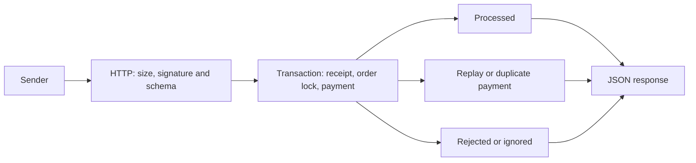

# Laravel Payment Webhooks

A Laravel demo that accepts signed payment events and keeps one payment per order, even on repeated or concurrent delivery.

The provider, `demo-pay`, is fictional. Amounts are integer minor units in EUR or USD.

| Runtime | Version |
| --- | --- |
| PHP | 8.5.12 |
| Laravel | 13.38.0 (`composer.lock`) |
| PostgreSQL | 18.6 |
| Composer | 2.10.3 |

## Run locally

You need Git, Docker with Compose v2, and Make. PHP and Composer run in containers.
After cloning this repository, run:

```sh
make setup
make demo
make verify
```

Setup creates local secrets, installs locked dependencies and starts the service.
The demo sends real HTTP requests and checks each response and database state.
It covers success, replay, an invalid signature and an event conflict.
Each run adds fresh demo orders and keeps existing data.

The local URL is `http://127.0.0.1:8088`; `/up` checks liveness only.
Set `APP_PORT` to use another port. Tests use a separate PostgreSQL server.
`make down` stops the stack and keeps demo data. `make reset-demo` explicitly deletes
all local demo orders, payments and receipts. The app uses PHP's development server
with four workers by default.

## What it guarantees

Inside one PostgreSQL transaction, the receiver saves a final event receipt,
creates a payment and marks the order paid. Row locks and unique constraints keep
repeated or competing requests from creating a second payment for an order.
A repeated event with the same bytes returns the saved decision.

This guarantee covers changes in this service's single database. Email, shipment
and external APIs need another delivery mechanism, such as an outbox. This demo
has no outbox, refund handling, partial payments or key rotation.



## One request and response

The [demo guide](docs/demo.md) records a real request and its response.
Send `POST /api/webhooks/demo-pay` with `Content-Type: application/json`, a current
`X-Webhook-Timestamp` and `X-Webhook-Signature: v1=` followed by the lowercase
HMAC-SHA256 of `timestamp + "." + raw body`, using the shared literal key.
The sender signs the bytes; do not reformat a signed body. The time window is
300 seconds in either direction and the body limit is 65,536 bytes.

The following body and 200 response come from a local demo run. Its IDs are
sample data; each new run creates its own orders. See the guide to reproduce it.

```json
{"id":"evt_01a1691a-2857-716a-8749-5f9d2bce303f","type":"payment.succeeded","data":{"payment_id":"pay_01a1691a-2857-716a-8749-5f9d2bd6f8a0","order_id":"01a1691a-2853-72c6-a0ec-e932e82b2dc7","amount_minor":12990,"currency":"EUR"}}
```

```json
{"event_id":"evt_01a1691a-2857-716a-8749-5f9d2bce303f","outcome":"processed","duplicate":false}
```

## Read the code

| File | Purpose |
| --- | --- |
| [Route](routes/api.php) | HTTP entry point |
| [Signature middleware](app/Http/Middleware/VerifyWebhookSignature.php) | Check timestamp and raw-byte HMAC |
| [Decoder](app/Validation/DecodeWebhook.php) | Strict JSON envelope and payment fields |
| [Controller](app/Http/Controllers/DemoPayWebhookController.php) | Map the final decision to JSON |
| [Processing action](app/Actions/ProcessWebhook.php) | Transaction, lock order and payment decisions |
| [Migrations](database/migrations/) | Unique, check and foreign key constraints |
| [Concurrency tests](tests/Feature/Webhooks/DemoPayConcurrencyTest.php) | Overlapping processes and database sessions |

## Documentation

| Guide | Content |
| --- | --- |
| [Demo](docs/demo.md) | Commands, expected states and a recorded run |
| [Architecture](docs/architecture.md) | Transaction boundary, constraints and logs |
| [Idempotency](docs/decisions/001-idempotency.md) | Event IDs, payment IDs and byte identity |
| [Synchronous flow](docs/decisions/002-sync-flow.md) | Failure recovery, retries and limits |
| [OpenAPI](docs/openapi.yaml) | Headers, schemas, responses and error codes |
| [Verification](docs/verification.md) | Runtime results and acceptance coverage |

`make verify` runs Composer validation, Pint, PHPStan level 8 and PHPUnit on real
PostgreSQL. Concurrency tests use independent OS processes and prove lock overlap.
The verification record states the tested source and any remaining release checks.

## License

[MIT](LICENSE), copyright 2026 Vladimir Chemeris.
