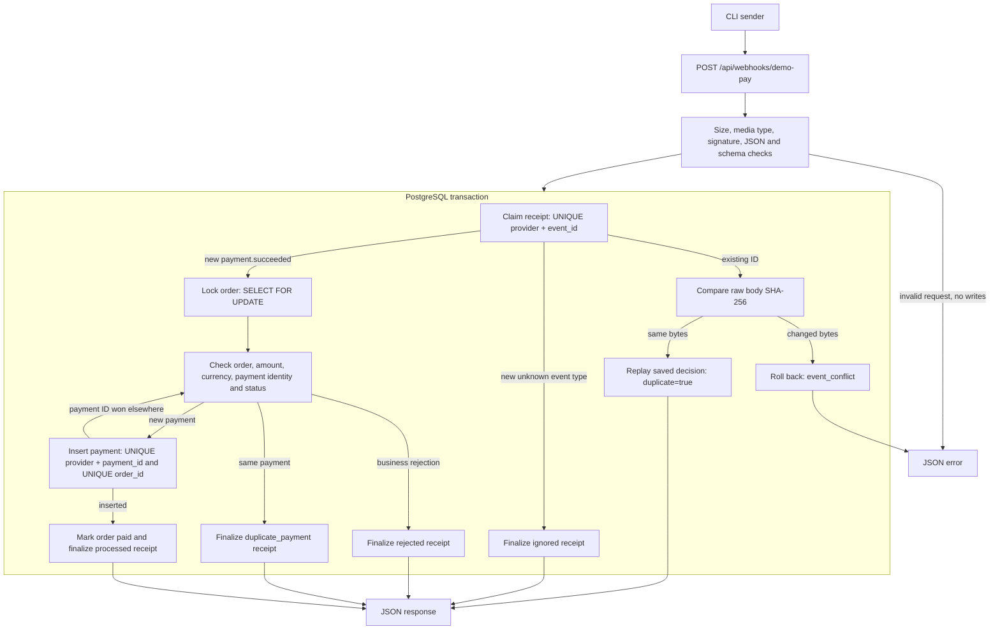

[README](../README.md) | [Demo](demo.md) | [Idempotency decision](decisions/001-idempotency.md)

# Architecture

The CLI sender calls the real HTTP endpoint. The controller decodes the signed
bytes and calls one action. That action owns one PostgreSQL transaction.

HTTP calls happen outside the receiver transaction. A processed receipt, payment
and paid order commit together. An exception before commit rolls them all back.
A rejected or ignored event commits its decision without a new payment.

The receipt claim uses `ON CONFLICT (provider, event_id) DO NOTHING RETURNING`.
For payment IDs the target is `(provider, provider_payment_id)`. After a conflict,
a separate statement reads the committed winner under Read Committed isolation.
The lock order is receipt slot, order row, then payment unique key.

The [migrations](../database/migrations/) also check amounts, currencies, provider,
status and the link between `status` and `paid_at`. The unique order index allows
at most one payment per order. The application transaction keeps payment and order
changes together; a database CHECK does not count payments across tables.
Receipts have an indexed order UUID without a foreign key, so a missing-order
rejection can be stored.

Default transaction settings are a 3000 ms lock timeout, a 10000 ms statement
timeout and at most three attempts for serialization failures or deadlocks.
Lock and statement timeouts return 503. See the [sync decision](decisions/002-sync-flow.md).

## Logs and errors

One receiver log line is written after each attempt: `request_id`, safe `event_id`
(or null before validation), `duplicate`, `duration_ms`, and `outcome` or
`error_code`. Database failures add `database_error_type`, `sqlstate` and
`exception_class`. Unexpected failures also include the exception class.
Success uses INFO, 4xx uses WARNING, and 5xx uses ERROR.

Each sender attempt logs `attempt`, `http_status`, `error_code` and `retry`.
Success uses INFO, failures use WARNING, and an exhausted retry budget uses ERROR.
`LOG_LEVEL` controls log detail. There is no payload, signature, secret, connection
string, SQL bindings or stack trace in these logs. Error responses contain only
`{"error":"<code>"}`. Business rejections use the documented receipt response.

The app uses PHP's development server with four workers by default. It is a local
demo, not a deployment guide. `GET /up` is a liveness check; it does not check the DB.

## Concurrency evidence

The [concurrency tests](../tests/Feature/Webhooks/DemoPayConcurrencyTest.php) use
two child OS processes with separate PostgreSQL sessions. A third session locks
the target order, and an observer checks `pg_stat_activity` and
`pg_blocking_pids`. Both workers must be waiting before the lock is released.
For the same event, one worker waits on the receipt owner, which waits on the
order lock. Tests check the set of results and the rows, without choosing a winner.

Fixtures are committed before workers start. Readiness, overlap, results and
cleanup have deadlines. Workers are stopped and temporary files are removed in
`finally`. Test workers use 15000/30000 ms lock/statement limits to allow observation;
these are separate from the application's 3000/10000 ms defaults.

## See also

- [Idempotency](decisions/001-idempotency.md)
- [Synchronous flow](decisions/002-sync-flow.md)
- [Verification record](verification.md)
